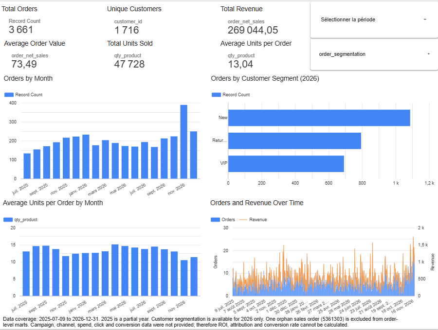
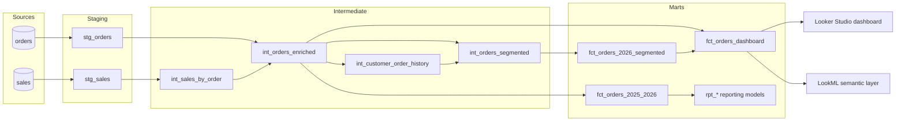

# E-commerce Analytics Engineering · dbt · BigQuery · Looker

[](https://github.com/Thierry-Daconceicao-Alvares/ecommerce-analytics-engineering/actions/workflows/ci.yml)


From raw order and sales extracts to tested dbt models, a governed LookML semantic layer and a marketing dashboard.

> **About this project.** An end-to-end analytics engineering case study on e-commerce order and sales data. The models were built and validated on BigQuery, exposed through a LookML semantic layer and a Looker Studio dashboard, and the project is packaged so that anyone can run it locally on DuckDB, with CI on every push.

## Key results

*Original dataset (2025-07-09 to 2026-12-31), BigQuery run.*

| Orders | Customers | Net sales | Average order value | Units per order |
|---:|---:|---:|---:|---:|
| 3,661 | 1,716 | 269,044 | 73.49 | 13.04 |

- **November is the peak month (389 orders) but has the smallest baskets**: 10.48 units per order, against 15.10 in March. More orders, fewer units each: worth checking whether November promotions trade basket size for volume.
- **Customer mix of 2026 orders**: 42% from New customers, 31% Returning, 27% VIP (4 or more orders in the previous 12 months).
- **Trustworthy numbers**: order amounts reconcile with their sales lines within 0.01, and the one anomaly the tests detected (a sales order with no matching order) is surfaced and documented instead of being silently dropped.

[](https://datastudio.google.com/reporting/78ef8242-016f-4e9a-b9d2-32bd7bb1bd66)

**[Open the Looker Studio dashboard](https://datastudio.google.com/reporting/78ef8242-016f-4e9a-b9d2-32bd7bb1bd66)**: built on the `fct_orders_dashboard` mart, with the data coverage and its analytical limits stated on the page ([specification](dashboard/dashboard_spec.md)).

**[Browse the dbt documentation and lineage graph](https://thierry-daconceicao-alvares.github.io/ecommerce-analytics-engineering/)**: every model, column, test and source, published from the synthetic sample data by a GitHub Actions workflow on every push.

## What this project demonstrates

| Skill | Where to look |
|---|---|
| Layered modelling with an explicit grain for every model | [`models/`](models), [grain table](#data-model-and-grain) |
| Fan-out prevention: aggregate sales lines before joining | [`int_sales_by_order`](models/intermediate/int_sales_by_order.sql) |
| Data quality engineering: 74 tests, including 5 business rules | [`tests/`](tests), [`_models.yml`](models/_models.yml) |
| Metric governance in a semantic layer | [`looker/`](looker) |
| Dashboard design that states what the data cannot prove | [`dashboard_spec.md`](dashboard/dashboard_spec.md) |
| One SQL codebase for two engines (BigQuery and DuckDB) | [`macros/cross_db.sql`](macros/cross_db.sql) |
| CI, SQL linting and pre-commit hooks | [`ci.yml`](.github/workflows/ci.yml), [`.sqlfluff`](.sqlfluff), [`.pre-commit-config.yaml`](.pre-commit-config.yaml) |

## Architecture



## Run it locally

No cloud account needed: the project runs on DuckDB with a synthetic dataset that has the same schema and date range as the original.

```bash
git clone https://github.com/Thierry-Daconceicao-Alvares/ecommerce-analytics-engineering.git
cd ecommerce-analytics-engineering
python -m venv .venv && source .venv/bin/activate   # Windows: .venv\Scripts\activate
pip install -r requirements.txt
python scripts/generate_sample_data.py
dbt build --profiles-dir profiles
```

Expected result: `PASS=85 WARN=1 ERROR=0`. The warning is intentional: the sample data contains one orphan sales order, reproducing the issue found in the original data. Browse the documentation and lineage with `dbt docs generate --profiles-dir profiles && dbt docs serve --profiles-dir profiles`, or use the `Makefile` (`make build`, `make lint`, `make docs`).

The sample data is synthetic (5,588 orders, 15,844 sales lines). Its figures differ from the key results above, which come from the original dataset.

## Design decisions

- **`orders` is the source of truth for the order grain.** Sales lines are aggregated per order before joining, so order-level measures can never be double counted.
- **Anomalies are surfaced, not hidden.** The orphan sales order is excluded from order-level marts and kept visible by a warning-level test.
- **Incomplete history is flagged, not guessed.** The data starts on 2025-07-09, so early-2026 orders do not have a full 12-month look-back: `history_window_complete` marks them, and their segment should be read with care.
- **2025 orders are never labelled `New` by default.** They have no segment in dbt and show as `Not available` in LookML.
- **Views everywhere, on purpose.** The BigQuery Sandbox used for the validated run expires tables after 60 days. In production, the facts would be incremental tables partitioned by `order_date` and clustered by `customer_id`.
- **One codebase, two engines.** BigQuery-specific SQL lives in [`macros/cross_db.sql`](macros/cross_db.sql). Its default implementations compile to the same SQL that was validated on BigQuery; the DuckDB versions power local runs and CI.

## Data model and grain

| Model | Layer | Grain |
|---|---|---|
| `stg_orders` | staging | one row per order |
| `stg_sales` | staging | one row per order and product |
| `int_sales_by_order` | intermediate | one row per order present in sales |
| `int_orders_enriched` | intermediate | one row per order from `orders` |
| `int_customer_order_history` | intermediate | one row per 2026 order |
| `int_orders_segmented` | intermediate | one row per 2026 order |
| `fct_orders_2025_2026` | mart | one row per 2025-2026 order |
| `fct_orders_2026_segmented` | mart | one row per 2026 order |
| `fct_orders_dashboard` | mart | one row per 2025-2026 order, segment for 2026 |
| `rpt_annual_order_count` | mart | one row for the analysis year |
| `rpt_monthly_order_count` | mart | one row per month of the analysis year |
| `rpt_monthly_avg_units_per_order` | mart | one row per month of the analysis year |

The three `rpt_*` models answer recurring reporting questions (orders per year, orders per month, average units per order per month) for the year set by the `analysis_year` variable (2026 by default).

## Metric definitions

- **Units per order** (`qty_product`) = `SUM(quantity)` over the order's lines. It counts units, not product references (`product_count`) or lines (`sales_line_count`).
- **Revenue** = `SUM(net_sales)` of `orders`, reconciled with the sales lines within 0.01.
- **Average order value** = revenue / number of orders.
- **Customer segment** of a 2026 order, from the orders placed by the same customer during the 12 months before the order date (same-day orders excluded): `New` = 0, `Returning` = 1 to 3, `VIP` = 4 or more.

## Data quality

| Check | Test | Severity |
|---|---|---|
| Keys unique and not null at every grain | generic `unique` / `not_null` | error |
| Segments limited to New, Returning, VIP | generic `accepted_values` | error |
| Order amount = sum of its sales lines (±0.01) | [`assert_order_sales_reconciliation`](tests/assert_order_sales_reconciliation.sql) | error |
| Every sales line points to an existing order | [`assert_sales_orders_references`](tests/assert_sales_orders_references.sql) | warn |
| Segment consistent with purchase history | [`assert_segmentation_consistency`](tests/assert_segmentation_consistency.sql) | error |
| One line per order and product | [`assert_unique_order_product`](tests/assert_unique_order_product.sql) | error |
| Quantities strictly positive | [`assert_positive_sales_quantities`](tests/assert_positive_sales_quantities.sql) | error |

## Semantic layer and dashboard

The [LookML layer](looker) exposes `fct_orders_dashboard` as an `orders` Explore with `order_id` as primary key and governed measures: orders, unique customers, revenue, average order value, units sold, units per order and product references per order. The [dashboard specification](dashboard/dashboard_spec.md) defines each chart by the business question it answers, and lists what the data cannot support (ROI, channel attribution, conversion rate), because it has no sessions, channels or ad spend.

## Run it on BigQuery

1. `pip install -r requirements-bigquery.txt`
2. Copy [`profiles.yml.example`](profiles.yml.example) to `~/.dbt/profiles.yml` and set your GCP project.
3. Load the `orders` and `sales` tables into the `ecommerce_raw` dataset. [`scripts/convert_excel_to_csv.py`](scripts/convert_excel_to_csv.py) prepares the CSV files from the Excel extracts.
4. `dbt build`

Variables: `raw_project` (defaults to the target project), `raw_dataset` (defaults to `ecommerce_raw`) and `analysis_year` (2026).

## Project structure

```text
.
├── models/
│   ├── staging/            typed and renamed sources
│   ├── intermediate/       aggregation, reconciliation, history, segmentation
│   ├── marts/              facts, dashboard mart, rpt_* models
│   ├── _models.yml         documentation and generic tests
│   └── exposures.yml       dashboard lineage
├── tests/                  singular business tests
├── macros/cross_db.sql     BigQuery / DuckDB SQL helpers
├── looker/                 LookML semantic layer
├── dashboard/              dashboard specification
├── scripts/                sample data generator, Excel to CSV
├── profiles/               DuckDB profile for local runs and CI
└── .github/workflows/      CI: build, tests, lint, docs
```

## Known limitations

- **The original data is not published.** The key results come from the original extracts loaded in BigQuery. The repository ships a generator of synthetic data with the same schema, so local and CI figures differ from the key results.
- **No marketing or web data.** Without sessions, channels or ad spend, the project cannot measure ROI, attribution or conversion rates; the [dashboard specification](dashboard/dashboard_spec.md) states it on the page.
- **Short history for early-2026 segments.** The data starts on 2025-07-09, so orders before July 2026 do not have a full 12-month look-back; `history_window_complete` flags them.
- **Views, not incremental tables.** Fine at a few thousand orders; a production volume needs incremental facts, partitioned and clustered.
- **The LookML layer is not deployed.** It is written and documented, but it has not been served or validated on a Looker instance; the Looker Studio dashboard reads the mart directly.
- **One known data issue stays at the source.** The orphan sales order is surfaced by a warning-level test and excluded from order-level marts, not corrected upstream.

## Next steps for production

- Incremental, partitioned and clustered fact tables.
- Source freshness checks and model contracts on the marts.
- Deploy the LookML project and point the dashboard at the Explore.
- Schedule the build with an orchestrator.

## Author

**Thierry Daconceição Alvares** · [LinkedIn](https://www.linkedin.com/in/thierry-alvares/) · [GitHub](https://github.com/Thierry-Daconceicao-Alvares)
